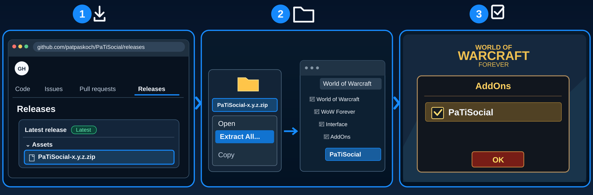

# PaTiSocial

## Install

**📥 [Download PaTiSocial Beta](https://github.com/patpaskoch/PaTiSocial/releases/download/v0.1.0-beta.1/PaTiSocial-0.1.0-beta.1.zip)** · [Installation guide](#installation)

*Installation-test preview — not yet a stable release.*

## What is PaTiSocial?

**Good adventures deserve a little personality.**

A quick hello, a well-timed cheer or a simple 'wait a moment' can make a party feel like a team. PaTiSocial keeps your favorite emotes and short messages one click away — without digging through chat commands.

## Features

- **Say it with a click:** Quick emotes and short party messages.
- **Your favorite actions:** Choose up to twelve buttons.
- **Keep it clear:** Tooltips show exactly what each button does.
- **Fits your screen:** Horizontal or vertical compact layouts.
- **Always your choice:** Nothing is sent automatically.

## Installation

1. 📥 **Download** – Open [GitHub Releases](https://github.com/patpaskoch/PaTiSocial/releases) and download the `PaTiSocial-<version>.zip` file under **Assets** (not **Source code (zip)**).
2. 📂 **Extract & Copy** – Right-click the ZIP, select **Extract All**, then copy the extracted `PaTiSocial` folder into the WoW Forever client's `Interface/AddOns/` folder. No renaming is needed.
3. ☑️ **Enable in Game** – Start WoW, open the **AddOns** menu at character selection, tick **PaTiSocial**, and click **OK**.

💡 **Tip – Find your WoW installation folder:** In the **Battle.net launcher**, select your WoW version, click the **gear icon next to Play**, and choose **Show in Explorer** (*Im Explorer anzeigen*). This opens the game's installation location in **Windows File Explorer**. From there, open `Interface/AddOns/` (or choose the correct WoW version folder first, if needed).

## Getting Started

- `/psocial` shows or hides the window; drag it by its header
- `/psocial settings` → choose the layout, how many buttons, and what each button does

## Settings

Use `/psocial settings` to choose the layout, button count and emote or message actions.

## Important notes

> **Installation-test beta available:** [Download the current ZIP from Releases](https://github.com/patpaskoch/PaTiSocial/releases). This is an unverified preview for testing the installation, not a stable release.

> Status: 0.1.0, in development, not yet stable. Not yet tested in game.

## Feature details

- Up to 12 buttons (4, 6, 8, 10 or 12 shown); every button can hold any action, or none
- **Emotes:** wave, hello, bow, salute, thanks, cheer, applaud, laugh, dance, joke — only those your client knows
  (PaTiSocial checks the client's own emote list; `/psocial debug` shows which ones)
- **Short messages:** "Hello!" (say); "Thanks!", "Let's go!", "Wait a moment, please.", "Stop.", "Help!", "Ready."
  (party); "Wait a moment, please." (raid). A party message works only in a group, a raid message only in a raid —
  otherwise the button is greyed out and says why. It never switches to another channel by itself
- Layout: horizontal (compact row) or vertical (one button per line)
- Tooltips: what the button does — emote, or which channel and the exact message
- ••• menu: Settings, Lock, Collapse/Expand, Hide. Settings: language, scale, lock, panel opacity, layout, number of
  buttons, the action of each button. Languages: English, Deutsch (others fall back to English)

Default buttons: Wave, Thanks, Laugh, Go! (party), Wait (party), Cheer.

## PaTiSuite

This addon is part of the **PaTiSuite** — a collection of small addons for World of Warcraft: Forever.
Each one is installed on its own and works on its own; none of them is needed by another.

- [PaTiSuite](https://github.com/patpaskoch/PaTiSuite) – optional control panel to show and hide the PaTi windows
- [PaTiHeal](https://github.com/patpaskoch/PaTiHeal) – healing: party frames, heal target, click casting, HoTs, dispels
- [PaTiAuras](https://github.com/patpaskoch/PaTiAuras) – buffs, procs, tracking, group buffs and weapon imbues
- [PaTiAggro](https://github.com/patpaskoch/PaTiAggro) – aggro for tank, healer and damage (formerly PaTiTank)
- [PaTiRota](https://github.com/patpaskoch/PaTiRota) – your own skill priority with cooldowns and fixed cast buttons
- [PaTiGroup](https://github.com/patpaskoch/PaTiGroup) – party awareness: tank, healer, roles and the tank's target
- [PaTiLead](https://github.com/patpaskoch/PaTiLead) – lead the group: raid markers, ready check and pull timer
- [PaTiQuest](https://github.com/patpaskoch/PaTiQuest) – selected quest and its objectives
- [PaTiDungeon](https://github.com/patpaskoch/PaTiDungeon) – instance, group and combat status
- **PaTiSocial** – "Party Social": quick emote and message buttons *(this addon)*
- [PaTiAlerts](https://github.com/patpaskoch/PaTiAlerts) – one window for open problems

### Goes well with (optional)

- [PaTiLead](https://github.com/patpaskoch/PaTiLead) – the other half of group play: markers, ready check, pull timer
- [PaTiSuite](https://github.com/patpaskoch/PaTiSuite) – shows and hides this window together with the other PaTi windows

## Commands

`/psocial` or `/patisocial` — alone: show/hide · `show` · `hide` · `lock` · `unlock` · `reset` (position) ·
`settings` · `debug` · `version`

## Known limitations

- Not yet tested in game; whether the Forever client's emote list and chat API behave as expected is unconfirmed.
- Only the predefined actions; own messages are not possible yet. Buttons show text, no icons.
- An emote is done at your current target (as in WoW); no target = a general emote.

## Development

Architecture, tests and engineering rules of the suite: [PaTiAdmin](https://github.com/patpaskoch/PaTiAdmin). PaTiAdmin is not a WoW addon — players do not install it. The shared UI code (PaTiShared) is already embedded in this addon's `Shared/` folder; there is nothing extra to install.

## License

MIT — see [LICENSE](LICENSE). Copyright (c) 2026 Patrick Koch.
